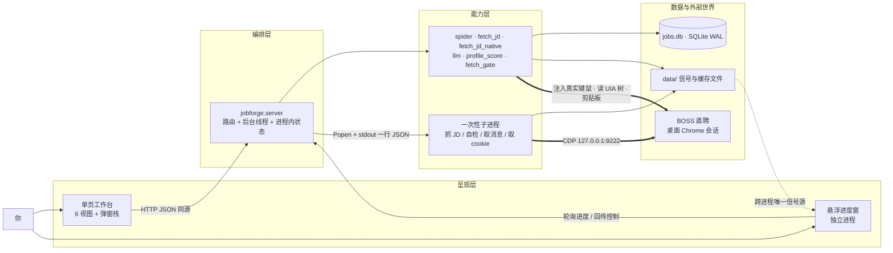
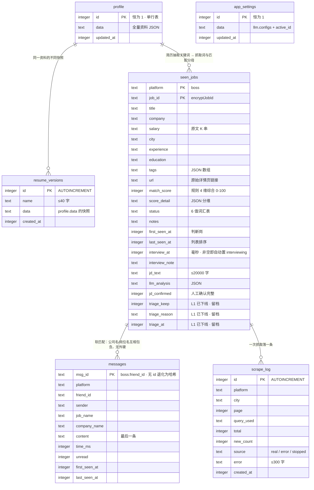
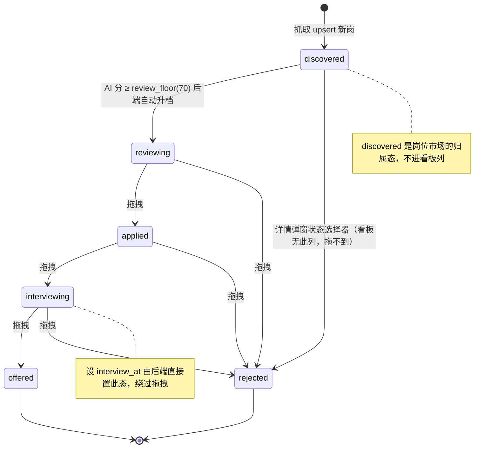
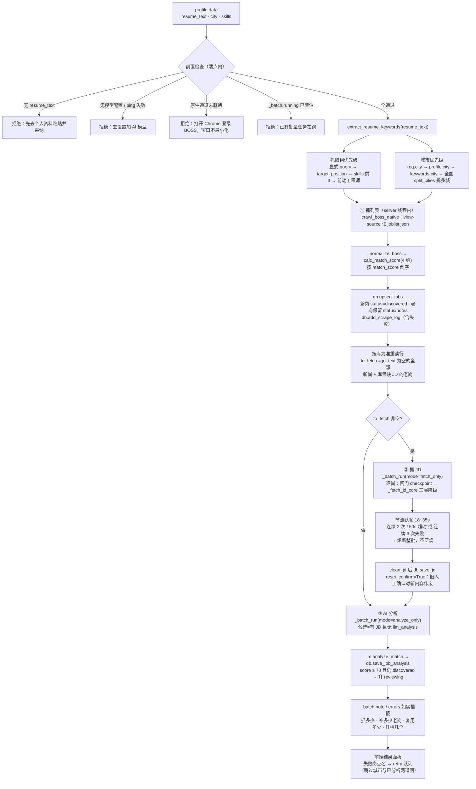
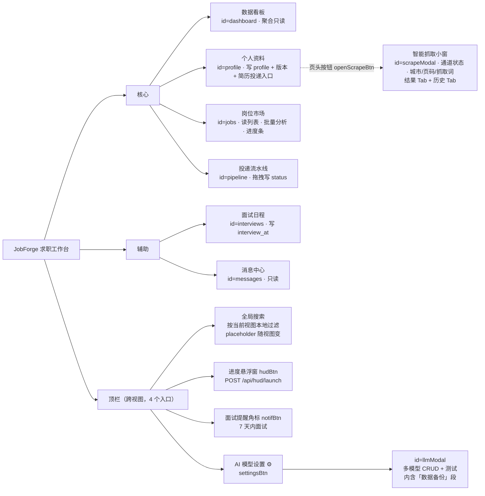

# JobForge 信息架构图

> 本文件画的是**信息在系统里的位置与走向**：谁产生、存在哪、被谁读、经哪条通道。
> 与 `README.md` 的分工：README 讲「怎么用 + 文件干什么」，本文件讲「为什么这么连」。
> 覆盖四张图：① 系统分层与进程拓扑 ② 数据模型与信息归属 ③ 主线信息流 ④ 前端信息架构。
> 末尾另有：唯一事实源清单（§6）、已下线/未接线端点（§6.1）、本图已知漂移点（§7）、过期校验命令（§8）。
> 端点按界面归属看 [§5.2](#52-视图--端点--数据实体)，按数据实体看 [§3](#3-图二--数据模型与信息归属)。

代码事实基准：`server.py` 44 个路由 / `db.py` 6 张表 / `web/job-workbench.html` 6 个视图。
校验方法见 [§8](#8-如何确认本图没过期)。

---

## 1. 全景：一张图看懂四层



读法要点，三条：

1. **只有一条链路会碰你的鼠标键盘**：能力层 → 桌面 Chrome。其余全部是本机内的 HTTP / 文件 / SQLite。
2. **数据层有两个平行的家**：结构化事实进 SQLite，跨进程协调状态进 `data/*.json`。判据是「谁需要跨进程看到它」。
3. **服务只绑 `127.0.0.1`**：接口无鉴权、库内含个人求职数据，不暴露到局域网。

---

## 2. 图一 · 系统分层与进程拓扑

```mermaid
flowchart TB
  subgraph U["用户侧（本机桌面）"]
    BR["浏览器标签页<br/>GET / → web/job-workbench.html"]
    CH["桌面 Chrome<br/>已登录 zhipin.com（登录态在此）"]
    HUD["悬浮进度窗进程<br/>-m jobforge.tools.hud"]
  end

  subgraph S["服务进程 · uvicorn @ 127.0.0.1:8080"]
    API["路由层（44 个端点）"]
    THR["后台线程<br/>_pipeline_worker / _batch_worker"]
    MEM["进程内状态<br/>_progress 进度 · _batch 批量"]
    SEG["单实例守卫 + --restart<br/>__main__ 启动路径"]
  end

  subgraph C["能力模块（server 同进程 import）"]
    SP["spider.py<br/>简历关键词抽取 · 4 维打分 · 多城列表抓取"]
    FJ["fetch_jd.py<br/>通道调度 auto/native/cdp + clean_jd"]
    FN["fetch_jd_native.py<br/>UIA 定位 · 键鼠注入 · 跨进程节流"]
    LM["llm.py<br/>OpenAI 兼容 chat + 3 个能力函数"]
    PS["profile_score.py<br/>13 项本地规则"]
    FG["fetch_gate.py<br/>暂停 / 停止 文件闸门"]
    PA["paths.py<br/>路径唯一来源"]
  end

  subgraph P["一次性子进程（cwd=项目根，stdout 末行 = JSON 契约）"]
    P1["-m jobforge.fetch_jd<br/>&lt;platform&gt; &lt;job_id&gt; &lt;url&gt; &lt;title&gt; &lt;company&gt;"]
    P2["-m jobforge.fetch_jd_native --check-json<br/>通道就绪自检"]
    P3["-m jobforge.tools.messages<br/>CDP 监听会话列表响应"]
    P4["-m jobforge.tools.grab_cookies<br/>CDP 读 zhipin cookie"]
  end

  subgraph D["数据层"]
    DB[("jobs.db<br/>SQLite WAL · 6 表")]
    GATE["fetch_gate.json<br/>{paused, stopped}"]
    THRO["fetch_throttle.json<br/>{next_ok_ts}"]
    CK["cookies.json"]
    MSG["messages.json"]
    POS["hud_pos.json"]
    CPR["chrome-profile/<br/>调试 Chrome 的 user-data-dir"]
    BAK["backups/backup-&lt;ts&gt;/"]
  end

  EXT["BOSS 直聘 zhipin.com"]

  BR <-->|"HTTP JSON"| API
  HUD -->|"GET /api/scrape-progress 600ms"| MEM
  HUD -->|"POST /api/scrape-control"| API
  API --> MEM
  API --> THR
  THR --> SP
  THR --> LM
  THR --> FG
  API --> PS
  API --> FN
  SP --> FN
  API -->|"Popen"| P1
  API -->|"Popen"| P2
  API -->|"Popen"| P3
  API -->|"Popen"| P4
  P1 --> FJ
  FJ -->|"首选 native"| FN
  FJ -.->|"兜底：CDP 页内 fetch"| CH
  FN ==>|"注入键鼠 / 读 UIA / Ctrl+A·C"| CH
  P2 -.->|"只读枚举窗口 + 读节流"| CH
  P3 ==>|"Playwright connect_over_cdp"| CH
  P4 ==>|"Playwright connect_over_cdp"| CH
  CH ==> EXT
  FN -->|"认领时段"| THRO
  FN -->|"安全点读"| GATE
  FG <--> GATE
  P3 -->|"写"| MSG
  API -->|"读后入库"| MSG
  P4 -->|"写"| CK
  SP -.->|"requests 兜底直连用"| CK
  HUD --> POS
  API --> DB
  THR --> DB
  API -->|"启动时 init_db"| DB
  API -->|"--restart 拉起"| CPR
  SEG -->|"探活 /api/whoami + netstat"| API
  PA -.->|"一切数据文件路径的唯一来源"| DB
```



### 2.1 进程清单

| 进程 | 拉起方式 | 生命周期 | 与 server 的通信 | 为什么必须独立 |
|---|---|---|---|---|
| `jobforge.server` | `run.bat` / `python -m jobforge.server` | 长驻，单实例 | — | — |
| `jobforge.tools.hud` | server `Popen`（抓取时自动）或 `POST /api/hud/launch` | 长驻到任务收尾后停留 9s | 轮询 `/api/scrape-progress`、POST `/api/scrape-control` | 三条窗口约束（置顶 / 不抢焦点 / 区域穿透）实测只在独立进程 + `WS_EX_TRANSPARENT` 下同时成立；抢焦点会撕断键鼠注入 |
| `jobforge.fetch_jd` | server `Popen`，管道两端钉 UTF-8 | 单岗一次，150s 超时 | stdout 末行 JSON `{ok, jd?, error?, stopped?}` | 子进程可被 `kill()`，让「停止」秒级生效；崩溃不带走服务 |
| `jobforge.fetch_jd_native --check-json` | server `Popen`（`/api/native/status`） | 2~5s | stdout JSON `{ok, chrome_found, chrome_ready, throttle_sec, error}` | 自检不导航、不抢焦点，与真抓取隔离 |
| `jobforge.tools.messages` | server `Popen`（`/api/messages/refresh`） | ~12s 监听窗口 | 落 `data/messages.json`，server 读文件入库 | 需要 Playwright 连 CDP；脚本崩溃也要读文件拿业务错误 |
| `jobforge.tools.grab_cookies` | server `Popen`（`/api/refresh-cookies`） | 短 | 落 `data/cookies.json` | 同上，CDP 侧独立 |
| 桌面 Chrome（用户的） | 你手动开 | 外部 | 无协议，只有 OS 层 | 登录态在浏览器进程里，抓取复用它，零 CDP 痕迹 |
| 调试 Chrome（9222） | server `_ensure_cdp_chrome` 按需拉起 | 外部，独立 profile | CDP over 127.0.0.1:9222 | 只在原生通道失败且 9222 不可达时才拉，平时系统保持无调试端口 |

### 2.2 四条抓取通道的优先级

```
岗位列表  spider.crawl_boss → fetch_jd_native.crawl_boss_native        （唯一路径：view-source 同源读 joblist.json）
JD 正文   ① 原生键鼠 fetch_jd_native  →  ② CDP 页内 fetch（需 9222）  →  ③ requests 直连详情页 HTML
消息      CDP 监听页面自己发出的会话列表 XHR（getGeekFriendList / geekFilterByLabel）
cookie    CDP context.cookies()
```

`FETCH_JD_MODE` 环境变量可钉死通道：`auto`（默认）/ `native` / `cdp`。三层降级的判定与熔断都在 `server._fetch_jd_core` 一份实现里，详情弹窗与批量共用。

### 2.3 跨进程协调：为什么是文件

`fetch_gate.json`（暂停/停止）与 `fetch_throttle.json`（节流时段）都是文件，原因相同：抓取有两种形态——列表抓取跑在 **server 线程内**，JD 抓取跑在 **子进程内**。`threading.Event` 只能覆盖前者，文件是两者都能读的唯一信号源。

写侧只有 server（`/api/scrape-control`、`/api/pipeline` 起始复位）；读侧是 `fetch_jd_native` 的安全点与 `_communicate_pausable`。写入走 `tmp + os.replace` 原子替换，读侧不会读到半个文件。`JOBFORGE_GATE_FILE` 可把闸门文件指向别处（测试隔离用，见 `tests/test_progress.py`）。

**暂停语义**：只在安全点生效（岗位边界、节流等待），绝不插在 `Ctrl+L`→粘贴→回车 这种连续动作中间；暂停期间超时倒计时不推进。
**停止语义**：置停止位 + kill 在跑的子进程，秒级生效；已入库的岗位与已完成的分析保留。

---

## 3. 图二 · 数据模型与信息归属

### 3.1 实体关系（6 张表，全部在 `data/jobs.db`）



四行**都没有外键约束**（库里只有主键与索引），画出来只为说明「信息从哪推导到哪」。区别只在派生方式：`resume_versions.data` 是 `profile.data` 的快照复制；`seen_jobs`↔`messages` 靠运行期的公司名/岗位名字符串匹配；`scrape_log` 与岗位只是同一次抓取的时间先后。

索引：`idx_seen_status(status)`、`idx_seen_first_seen(first_seen_at)`、`idx_seen_interview(interview_at)`、`idx_messages_time(time_ms)`、`idx_scrape_log_time(created_at)`。

### 3.2 JSON-in-column：列里藏着第二层结构

SQLite 只有标量列，真正影响前端渲染的结构挤在 TEXT 列里。改这些 schema 不会报错，只会让读它的人静默降级——所以逐个列清：

| 宿主列 | 形状 | 谁写 | 谁读 |
|---|---|---|---|
| `seen_jobs.tags` | `string[]` | 原生通道归一 | 规则打分的技能分母 / 卡片标签 |
| `seen_jobs.score_detail` | `{overall, skills_match, experience_match, salary_match, location_match, reasoning}` | `spider.calc_match_score` | 卡片迷你条、详情弹窗分维 |
| `seen_jobs.llm_analysis` | `{verdict, score, strengths[≤4], gaps[≤4], advice[≤3], model}` | `llm.analyze_match` | 卡片蓝标「AI xx」、详情弹窗 AI 段、升档判定 |
| `seen_jobs.jd_text` | 纯文本，`clean_jd` 出口兜底清洗 | 三层降级抓取 / 详情弹窗重抓 | 弹窗正文、`llm.analyze_match` 输入 |
| `profile.data` | `{name, phone, email, target_position, city, expected_salary, skills[], summary, experience, education, projects, resume_text}` | `PUT /api/profile`（全量覆盖） | 抓取词与城市、打招呼语、润色、打分、流水线前置检查（缺 `resume_text` 直接拒跑） |
| `app_settings.data` | `{llm: {configs: [{id, name, base_url, api_key, model}], active_id}}` | `PUT /api/llm/configs` | `_get_llm_config`（显式 model_id → active → 第一个） |

`api_key` 只存本地 SQLite，读出时一律脱敏成 `****尾4位`；前端把掩码串回传时按 id 沿用旧真值，不会覆盖。

### 3.3 `data/` 文件归属

| 文件 | 写者 | 读者 | 进备份 | 删掉会怎样 |
|---|---|---|---|---|
| `jobs.db` (+`-wal`/`-shm`) | server 全部写路径 | server | 是（SQLite backup API 热备） | 所有岗位、资料、配置从零 |
| `cookies.json` | `tools.grab_cookies` | `spider._load_cookies`（仅 requests 直连兜底） | **否**（登录态凭据，可随时重抓） | 第三层兜底失效，前两层不受影响 |
| `messages.json` | `tools.messages` | server 读后入 `messages` 表 | 是 | 无影响，下次刷新重建 |
| `fetch_gate.json` | server（`fetch_gate`） | `fetch_jd_native` / `_communicate_pausable` | 否 | 无影响，任务启动即复位 |
| `fetch_throttle.json` | `fetch_jd_native`（认领时段） | 同模块 + 状态展示 | 否 | 节流归零——**别在抓取中途删**，等于放弃频率防护 |
| `hud_pos.json` | `tools.hud` | `tools.hud` | 否 | 悬浮窗回到默认右下角 |
| `chrome-profile/` | 调试 Chrome | 调试 Chrome | 否 | CDP 通道的 BOSS 登录态丢失，需重新登录 |
| `backups/backup-<ts>/` | `POST /api/backup` | `GET /api/backup/list` | — | 只留最近 10 份，超出自动删 |

整个 `data/` 在 `.gitignore` 里，永不入库。备份只含 `jobs.db` + `messages.json`，且备份失败会 `rmtree` 不留半份坏备份。

### 3.4 投递状态机（`seen_jobs.status`）



三条硬规则：① 自动升档**只向前不回退**（已在 applied/interviewing/终态的一律不动）；② 终态 `rejected`/`offered` **各自一列不合并**（语义相反，合列会藏漏斗信息并让拖放写错状态）；③ `interview_at` 非空是把状态改成 `interviewing` 的第二条写入路径。

`discovered → reviewing` 的分数线叫 `review_floor`，由后端随岗位列表下发，前端不自定阈值。看板列序由 `KANBAN_COL_ORDER` 显式声明 5 列：`reviewing → applied → interviewing → offered → rejected`（`discovered` 不占列，`rejected` 固定末列），词汇表 `STATUS_META` 的原序不随列序改动 —— 列键与词汇表的一致性由 `tests/test_frontend_status_contract.py` 钉住。

---

## 4. 图三 · 主线信息流（一键智能抓取 `/api/pipeline`）



三段共用一份循环体（`_batch_run`），停止/暂停/熔断口径只有一份。三段之间**只在阶段边界检查停止**：段内点停止则该段自然收尾，后续段不再开始。

`analyze_only` 不挂 checkpoint —— 它不碰键鼠，没有该被暂停的理由。

同一条 `_batch_run` 还服务另两条入口：

| 入口 | 队列构造 | mode | 说明 |
|---|---|---|---|
| `POST /api/analyze-batch`（岗位市场「AI 分析」） | `_analyze_queue`：L0 城市门槛 → 去已分析 → 截 limit | `fetch_and_analyze` 或 `analyze_only`（看队列里 `need_jd` 是否 >0） | 缺 JD 的岗留在队列里，跑到它先抓再分析 |
| `POST /api/analyze-batch` + `retry:[...]`（失败点名） | `_retry_queue`：两道闸都不拦 | 同上 | 缺 JD 真抓，已有 JD 只重做分析 |
| `POST /api/analyze-batch` + `only:[...]` | 收窄候选集，闸门照常 | 同上 | 与 retry 的区别是「收窄」不是「放行」 |

**L0 城市门槛**在两处生效且口径一致：`_analyze_queue` 与 `/api/jobs`（默认只返回期望城市，`all_cities=true` 看全部，每条带 `city_ok`）。看板与面试日程取岗一律用 `all_cities=true` —— 投递跟踪是你自己的事实，不该被城市门槛截断。

---

## 5. 图四 · 前端信息架构

### 5.1 导航树与视图职责



`#scrapeModal` 挂在「个人资料」页头按钮上（HTML 注释也这么标），但它启动的流水线进度显示在**岗位市场顶部进度条**与**悬浮窗**两处 —— 触发点与观察点分属两个界面，这是这套 IA 里最容易看错的一条线。

### 5.2 视图 → 端点 → 数据实体

| 视图 | 读 | 写 | 落到的实体 | 口径备注 |
|---|---|---|---|---|
| 数据看板 | `/api/stats` | — | `seen_jobs` 聚合 | 全库口径，不受城市门槛影响；状态分布复用 `STATUS_META` |
| 个人资料 | `/api/profile`、`/api/profile/score`、`/api/profile/versions` | **落库**：`PUT /api/profile`、`POST /api/profile/versions`、`POST /api/profile/versions/{id}/apply`、`DELETE /api/profile/versions/{id}`<br>**纯计算（POST 不写库）**：`POST /api/resume/extract`、`POST /api/resume/upload-pdf`、`POST /api/polish` | `profile`、`resume_versions` | PDF 上传→抽文本→解析→**字段级 diff→用户采纳**（统一走 `PUT /api/profile`）才落库；润色同样先 diff 后采纳；扫描件抽不到文本服务端直接 422 |
| 岗位市场 | `/api/jobs?all_cities=`（含 `review_floor`）、`/api/analyze-batch/status`、`/api/scrape-progress` | `POST /api/analyze-batch`（含 `retry`/`only`/`force`/`limit`）、`POST /api/analyze-batch/stop`、`PATCH /api/jobs/{p}/{id}` | `seen_jobs.llm_analysis/jd_text/status` | JD 覆盖条**前端本地按当前列表算**（`_computeJdStats`），非 `/api/jobs/jd-stats`；批量进度条在此显示，也是流水线的观察点；升档分数线由后端下发，前端不自定 |
| 智能抓取小窗 `#scrapeModal` | `/api/native/status`、`/api/scrape/logs`、`/api/llm/configs`（轻预检） | `POST /api/pipeline` | `seen_jobs`、`scrape_log` | 由**个人资料页头按钮**唤起；城市/页码/自由抓取词三项入参；结果 Tab + 历史 Tab；「隐藏已看」开关走 localStorage |
| 投递流水线 | `/api/jobs?all_cities=true` | `PATCH /api/jobs/{p}/{id}`（拖拽写 status）、`POST /api/interviews` | `seen_jobs.status` | 5 列，`discovered` 不占列；PATCH 后同步本地缓存再重渲染，不重新拉全量、不触发抓 JD |
| 面试日程 | `/api/interviews` | `POST /api/interviews` | `seen_jobs.interview_at/interview_note`（+ 自动置 `status`） | 已安排（有时间正序）+ 待安排（`interviewing` 未定时间）；7 天内面试角标与通知 |
| 消息中心 | `/api/messages`（`limit=500`，带 `total`/`truncated`） | `POST /api/messages/refresh` | `messages` | 只读展示；会话→岗位靠公司名/岗位名互相包含（≥4 字）模糊匹配，匹配不上不硬猜 |
| 岗位详情弹窗（跨视图共用） | `/api/jobs/{p}/{id}`、`/api/jobs/{p}/{id}/jd`、`/api/llm/configs`、`/api/profile` | `POST /api/match-analysis`、`/api/greeting`、`/api/jobs/{p}/{id}/jd-confirm`、`PATCH` | `seen_jobs.jd_text/llm_analysis/status/jd_confirmed` | 打开即自动跑 AI 分析；抓 JD 会接管键鼠，复用同一进度作用域（嵌套不抢显示） |
| 设置 ⚙ | `/api/llm/configs`、`/api/backup/list` | `PUT /api/llm/configs`、`POST /api/llm/test`、`POST /api/backup` | `app_settings`、`data/backups/` | 表单直测传 `config`（真密钥），测已保存配置传 `id` |

`STATUS_META`（前端）与 `db.VALID_STATUSES`（后端）是**同一个词汇表的两个副本**，看板列、详情弹窗状态组、仪表盘管道、状态下拉全部从 `STATUS_META` 派生 —— 不允许任何一处另写一套状态名。

### 5.3 弹窗栈（z-index 从高到低，Esc 逐层关）

```
230 .modal--alert   #promptModal      通用输入（替代原生 prompt）
220 .modal--cfg     #polishModal  #llmModal
210 .modal--detail  #jobDetailModal
205 .modal--stack   #batchResultModal  #scrapeModal  #versionsModal
200 .modal（基类）   #ivwModal
```

抓取小窗刻意压在岗位详情**之下**（205 < 210）：从抓取结果里点开工位详情时，抓取面板要保持可返回、两层同时可见。`#llmModal` 与 `#polishModal` 同层，让「随时改模型」和「正在看 diff」互不打架。

> `web/job-workbench.html:3926` 的注释只枚举到 220，漏了 230；实际顺序以同处的 `ORDER` 数组为准，本图按 CSS 值与 `ORDER` 双份核对过。

### 5.4 第三类存储：浏览器 localStorage

有 5 个用户选择既不进 SQLite 也不进 `data/`，只活在浏览器本地 —— 换浏览器就回默认值，这是排查「我明明关掉了怎么又开了」的第一现场。

| 键 | 归属界面 | 含义 |
|---|---|---|
| `jf_hide_seen` | 智能抓取小窗 | 结果里隐藏已入库的岗 |
| `jf_only_city` | 岗位市场 | 只看期望城市（与后端 L0 门槛同口径的 UI 开关） |
| `jf_sort` | 岗位市场 | 排序方式 |
| `jf_status` | 岗位市场 | 状态筛选 |
| `jf_jd` | 岗位市场 | JD 覆盖条点选出的筛选（已获取 / 未获取 / 疑似残缺） |

`STATUS_META`（前端）与 `db.VALID_STATUSES`（后端）是**同一个词汇表的两个副本**，看板列、详情弹窗状态组、仪表盘管道、状态下拉全部从 `STATUS_META` 派生 —— 不允许任何一处另写一套状态名。

---

## 6. 唯一事实源清单（改信息前先看这张表）

| 概念 | 正本 | 副本 | 谁钉住一致性 |
|---|---|---|---|
| 一切路径 | `paths.py`（`PROJECT_ROOT`/`DATA_DIR`/`WEB_DIR`/`data()`/`module_file()`） | 无 —— 任何模块不得从自己 `__file__` 反推 | 目录重构的历史事故：数据被静默留在旧位置 |
| 投递状态词汇 | `db.VALID_STATUSES` + 前端 `STATUS_META` | 看板列序、管道、下拉、卡片色全从这两处派生 | `tests/test_frontend_status_contract.py`（同集合 + 每态可达） |
| 暂停/停止信号 | `fetch_gate.json` | `_batch.stop`/`_batch_cancel`（进程内，与文件位并存） | `tests/test_progress.py`（`JOBFORGE_GATE_FILE` 隔离） |
| JD 覆盖口径 | 前端本地 `_computeJdStats`（当前列表口径）／后端 `db.get_jd_stats`（全库口径） | **两份实现，前端只用了自己那份** → 见 §7 漂移点 | `tests/test_db.py::test_jd_stats` 只钉后端份 |
| 抓取循环的停止/熔断口径 | `server._batch_run`（一份） | 无 —— 流水线曾自己抄了一遍并只认超时，已合并 | 见 `_batch_run` 头注释（2026-10-09 修） |
| 匹配分母与打分维度 | `spider.calc_match_score` | `score_detail` 落库供回看 | `tests/test_spider.py` |
| LLM 配置选择顺序 | `server._get_llm_config` | 弹窗与批量的 model_id 透传 | `tests/test_server.py` |
| 子进程可引导性 | `-m jobforge.*` + `PYTHONPATH=src` | server 启动兜底注入 PYTHONPATH | `tests/test_package_imports.py`（静态扫平级导入 + 子进程冒烟） |
| `.bat` 行尾 | `.gitattributes` `*.bat text eol=crlf` | — | LF 下 cmd.exe 按字节偏移误解析，静默吃掉 `set "PYTHONPATH=..."` |

### 6.1 现存技术债 / 已下线但保留

- **L1 粗筛整族已下线**（2026-10-09），`triage_keep/triage_reason/triage_at` 三列与历史数据按裁定保留供复核；`init_db` 里那条 `UPDATE ... WHERE triage_keep=1` 只剩兜老库的作用。
- 升档入口已从「粗筛 keep=1」改为「AI 分 ≥ 70」。
- `use_mock` 参数、`CrawlReq.platform="all"` 属兼容签名，实际只有 `boss`。
- 前端未接线的端点见下表 —— 它们是**能力不是界面**，删它们要连带删对应测试与内部调用方。

| 端点 | 前端调用数 | 真实消费者 |
|---|---|---|
| `GET /api/platforms` | 0 | 启动探活与实例身份判定（结构即指纹） |
| `GET /api/whoami` | 0 | `--restart` 三重判定（自报 PID） |
| `POST /api/crawl` | 0 | 单页列表抓取，被 `/api/pipeline` 取代的独立入口 |
| `POST /api/scrape-from-resume` | 0 | `_pipeline_worker` 直接调函数体，不走 HTTP |
| `GET /api/cookie-status` / `POST /api/refresh-cookies` | 0 | cookie 子系统；产物只服务第三层 requests 兜底 |
| `GET /api/jobs/jd-stats` | 0 | 全库口径统计，前端改用本地列表口径 → §7 |

---

## 7. 本图已知漂移点（写图时发现，未修）

1. **JD 覆盖统计有两份实现，UI 只接了本地那份。** `web/job-workbench.html:1257` 的提示文案写「全库口径见数据看板」，但看板 `/api/stats` 并不含 JD 覆盖字段 —— 全库口径实际上无处可看。要么让看板接 `/api/jobs/jd-stats`，要么改文案。
2. **README 的「两档匹配」表述与 L1 下线后现状有落差。** README 讲 tag 粗筛（抓取时算）+ JD 精配，这与代码一致；但同一份 README 未提「已分析过的岗不再重复烧 token」「缺 JD 的老岗会被补抓」这两条额度口径，用户体感时长由它们主导。
3. **`_batch` 是进程内字典**，页面刷新后 `/api/analyze-batch/status` 仍能拿到，但**服务重启即丢**——批次结果面板靠 `finished_at` 判快照新旧，重启后的「上次结果」不存在。这不算 bug，属于「进度态刻意不落库」的设计，图上标出以免误加持久化。

---

## 8. 如何确认本图没过期

图里的三个数字最容易漂，各自一条命令：

```bash
# 路由数（图说 44）
grep -c '^@app\.\(get\|post\|put\|patch\|delete\)' src/jobforge/server.py
# 表数（图说 6）
grep -c 'CREATE TABLE IF NOT EXISTS' src/jobforge/db.py
# 前后端状态词汇是否仍同集合（图说 6 值）
venv/Scripts/python.exe -m pytest tests/test_frontend_status_contract.py -q
```

新增一个视图 / 表 / 通道时，按这个顺序改：`§5.2` 或 `§3.1` 的表 → 对应 Mermaid 节点 → `§6` 唯一事实源表（若引入了新副本）。
